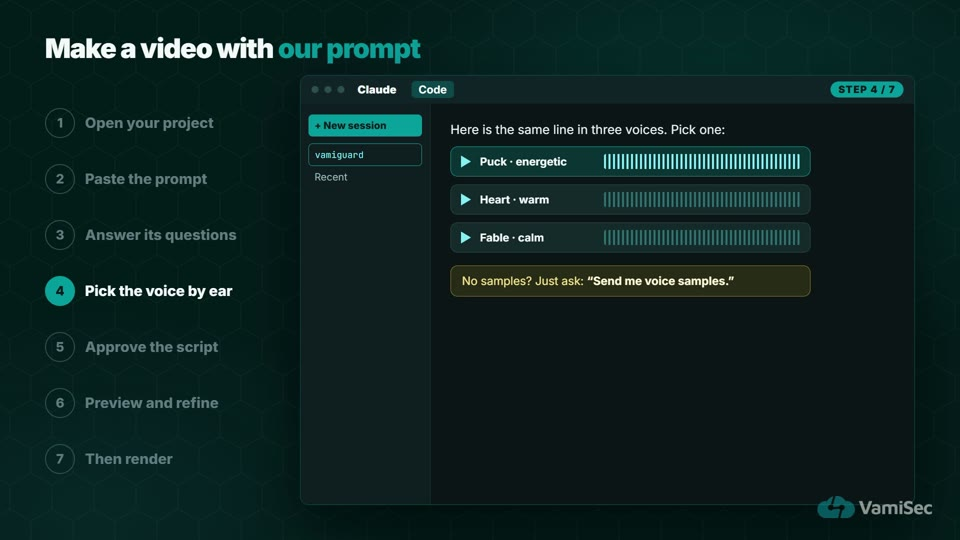
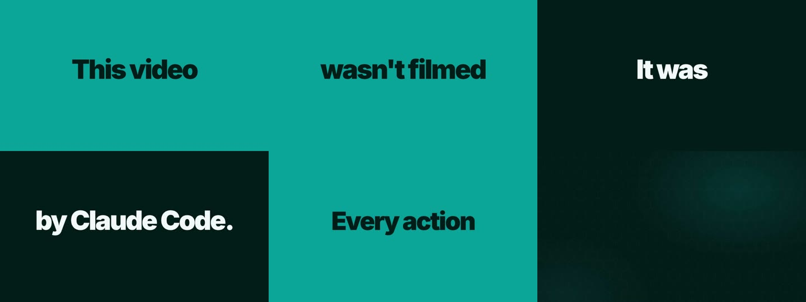
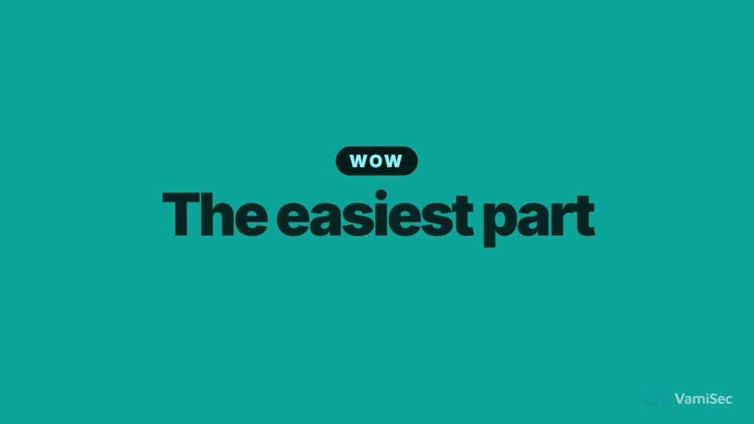
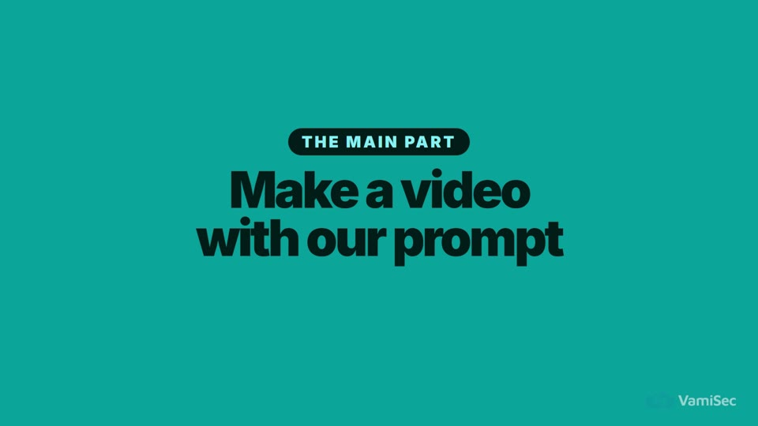
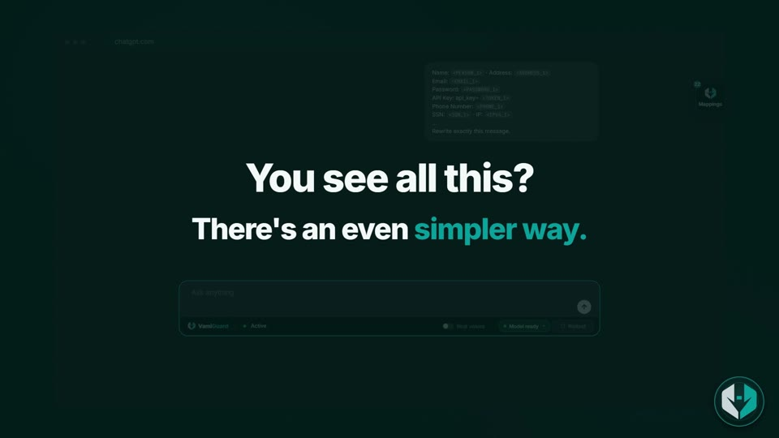
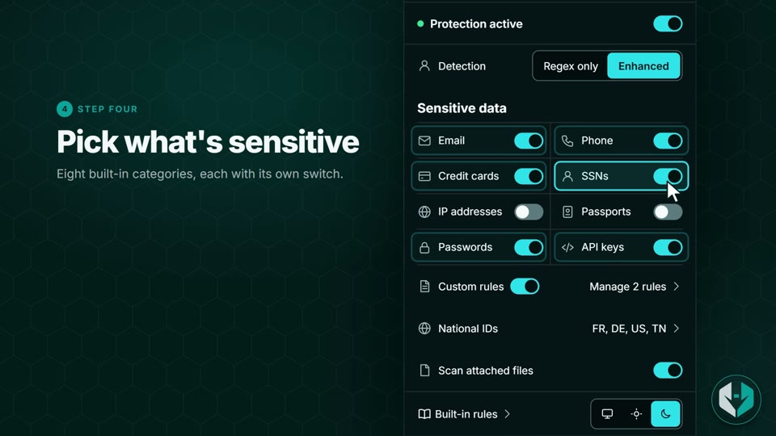
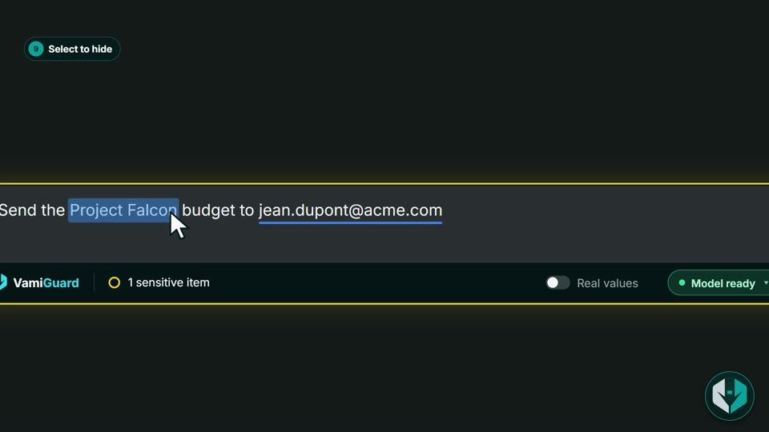
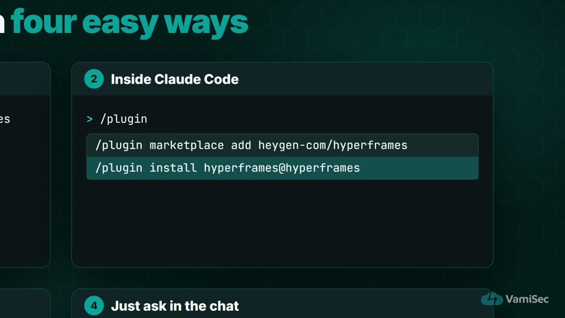
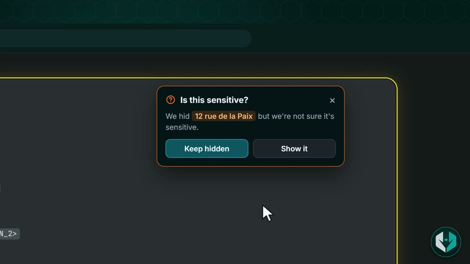
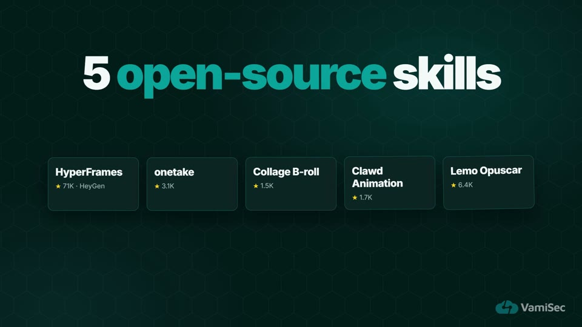

# Editing Master

A Claude Code skill that turns your product into a short, hooking video: one-word screens,
hook cards, camera zooms, cursor clicks, transitions, a voiceover, music and subtitles.
Claude asks what you want, lets you hear every voice and track before it goes in, and
renders only when you approve. Take the **fast track** (three stops before render) or go
**step by step**.


Works from whatever you have:

- **a codebase** (the folder you are in),
- **a link** to your live app or website,
- **screenshots or a screen recording**,
- or **just a description**.

## Install

As a plugin (recommended):

```bash
claude plugin marketplace add Maher-bouchrara/Editing-Master-skill
claude plugin install editing-master@editing-master
```

Inside a Claude Code session, the same with `/plugin marketplace add …` and
`/plugin install …`. Or ask Claude in the chat:
*"Install the editing-master skill from github.com/Maher-bouchrara/Editing-Master-skill."*

It builds on HyperFrames, so install that too:

```bash
claude plugin marketplace add heygen-com/hyperframes
claude plugin install hyperframes@hyperframes
```

Restart Claude Code after installing.

## Use

Open Claude Code on your project (or anywhere, if you have a link or screenshots) and ask:

```text
Make a video for this project.
```

Claude asks **what video you want** first: what it's for, who watches it, how long, the one
message to remember. You can also say it right away:

```text
A 30-second vertical teaser of https://my-app.example.com, for new customers.
```

It also asks how you want to work. Either way, nothing goes into the video that you haven't
seen or heard, and nothing renders before you approve the preview.

### Fast track (recommended)

The machine work is quick; what takes time is stopping to answer. The fast track asks
everything at once and does the work in between, so you stop only three times:

1. **The plan.** One message: your brief, which video skill (with a recommendation), and
   the style questions, each with a default. Answer what you want to change, or say
   **"use your picks"**.
2. **Script, screens and sounds.** One message: the script, a rebuilt screen, and a
   listening pack (3 voices, 3 music samples, a voice + music mix, the sound effects).
   Approve and pick in one reply.
3. **Preview.** Ask for changes in plain words; repeat until you love it.

Then say **"render"**. Say "slow down" at any time to switch to step by step.

### Step by step

One step at a time, and it asks before each next step:

1. **What video?** It repeats your brief back; you say yes.
2. **Which video skill?** It shows a menu of video skills and recommends one for this
   video (HyperFrames by default).
3. **Style.** Presenter, cursor clicks, zooms, one-word screens, subtitles (burned in or
   separate files), brand colours; each with options and a recommendation.
4. **Voice: listen, then choose.** The same line in 3 voices.
5. **Music: listen, then choose.** 15–20 s samples of 3 tracks, then a voice + music mix.
6. **Sound effects: listen, then confirm.** Clicks, pops, whooshes.
7. **The screens and steps.** It shows a rebuilt screen and the steps it will show.
8. **Script.** You approve it, then listen to the full voiceover.
9. **Preview.** Ask for changes in plain words ("slower here", "zoom on the popup",
   "subtitles smaller"). Repeat until you love it.
10. **Say "render".**
11. **Hand over.** The video, covers, script and subtitles in the form you chose.

In both modes it tells you how long each part takes (see "How long it takes").



## What it does for you

### Hooks and one-word screens

Full-colour screens, one or two words per beat, each on its spoken word.




| Hook card before the easiest step | Chapter card for the main part |
|---|---|
|  |  |

| Pattern break | Brand reveal |
|---|---|
|  |  |

### Camera, cursor and step chips

Push in on the control being named, click on the word, hold, pull back.

| Step chip and real UI | Zoom on the action |
|---|---|
|  |  |

| Readable commands | A decision moment |
|---|---|
|  |  |

### Voice, music, subtitles

- Free voices on your laptop (Kokoro), or paid (HeyGen, ElevenLabs).
- One quiet music bed (≈ 16 % under the voice), effects only on visible actions.
- Subtitles your way: **burned into the video** (always visible, one language, good for
  muted social clips) or **separate `.srt` / `.vtt` files** (one per language, editable by
  hand, switchable in the player). Or both.

## Which skill?

Editing Master's building blocks (one-word screens, camera, cursor, starter) are
HyperFrames, the default. Right after your brief, Claude shows a menu of video skills, each
with what the video looks like, what it's best for, time and cost, and recommends one for
your project. Each has its own workflow. Full descriptions and install commands are in
[`references/video-skills.md`](skills/editing-master/references/video-skills.md).



**Build a video from scratch**

| Skill | What you get | Best for | Time | Licence / cost |
|---|---|---|---|---|
| [HyperFrames](https://github.com/heygen-com/hyperframes) (default) | Real UI, camera zooms, cursor clicks, one-word screens | Product walkthroughs, how-tos | render ≈ 1.3 s per second, CPU | Apache-2.0, free |
| [onetake](https://github.com/feitangyuan/onetake) | One continuous camera move, motion blur | Launch films, teasers | render ≈ 18 s per second, CPU | Noncommercial; onetake Pro for business |
| [Collage B-roll](https://github.com/pyang5166/gbro-collage-broll) | Stop-motion paper collage | Playful B-roll, social clips | render ≈ 3.5 s per second | MIT; paid Gemini key |
| [Clawd Animation](https://github.com/JohnHeibel/ClaudeAnimationBase) | Hand-drawn watercolour | Storybook brand films | render ≈ 21 s per second, GPU | MIT, free; GPU |
| [Lemo Opuscar](https://github.com/lemomo-ai/lemo-opuscar) | Flat 2D cartoon with characters | Story films from a brief | 16 s clip in 12 s + ≈ 8 min agent work | MIT, free |
| [explainroo](https://github.com/vincentsch/explainroo) | Narrated drawings that appear on the spoken word, 6 looks | Explainers, YouTube | ≈ 2 min for a 15 s promo* | MIT, free |
| [iart explainer skills](https://github.com/iart-ai/explainer-video-skills) | Whiteboard, diagrams, isometric scenes, "Wrapped" recaps | Explainers, data stories, bulk personalised videos | not measured | MIT, free |
| [Manim](https://github.com/Yusuke710/manim-skill) | 3Blue1Brown-style maths animation with narration | Maths, algorithms, research | not measured | MIT, free; LaTeX |
| [Remotion](https://github.com/remotion-dev/skills) | Motion graphics written in React | React teams, data-driven videos | ≈ 4.5 min for a 15 s promo* | Free up to 3 people; company licence above |
| [Animate](https://github.com/cth9191/animate) | Cut paper, riso, pixel art, sketchbook and more | Stylised shorts and stories | not measured | MIT, free |
| [Guizang product video](https://github.com/op7418/guizang-product-video-skill) | Release promo from the product's real components | Software update promos | ≈ 8.6 min for a 15 s promo* | AGPL-3.0 (+ BSL parts) |
| [OpenMontage](https://github.com/calesthio/OpenMontage) | Montages from stock/archive footage, trailers, dubbing | Documentary-style videos | ≈ 8.6 min for a 15 s promo* | AGPL-3.0; optional paid AI ≈ $1–5 per video |
| [Lottie](https://github.com/diffusionstudio/lottie) | Lottie JSON for websites and apps (not an MP4) | In-app and web animations | ≈ 5.6 min for a 15 s promo* | MIT, free |

**Edit a video you already have**

| Skill | What it does | Time | Licence / cost |
|---|---|---|---|
| [Clipify](https://github.com/louisedesadeleer/clipify) | Long video → vertical shorts that follow the speaker, with captions | ≈ 20 s per 20 s clip (author, Apple Silicon) | MIT, free; macOS |
| [Cut Video](https://github.com/louisedesadeleer/cut-video) | Removes silences, filler words and retakes | 7-min 4K interview in ≈ 30 s (author, Apple Silicon) | MIT, free; macOS |

\* Start to finish, including the agent's writing time, from the same-brief test in
[awesome-claude-video-skills](https://github.com/zhuyansen/awesome-claude-video-skills).
Render times for the first five were measured by us, render only.

## How long it takes

| Step | Typical time on a laptop |
|---|---|
| One voice line (Kokoro, free) | ≈ 5 s, mostly loading the model |
| A whole 2-minute script (Kokoro) | ≈ 1 min |
| Paid voices (HeyGen, ElevenLabs) | fast; need an account and an API key |
| Find and download a free CC music track | ≈ 1 min, plus a short sample cut |
| Generate music locally (MusicGen) | slow on a CPU: several minutes |
| Subtitles for a 4-minute film | ≈ 20 s |
| Render (plain HyperFrames) | ≈ 1.3 s per second of video (a 2:11 film in 2 min 46 s) |
| Render (other skills) | ≈ 3.5–21 s per second of video, see "Which skill?" |
| Your review loops | most of the time |

## What's inside

```
skills/editing-master/
  SKILL.md                         the workflow Claude follows
  references/
    kinetic-type-and-hooks.md      one-word screens, hook and chapter cards, script rules
    transitions-and-camera.md      focus camera, cursor, six transitions and when to use them
    pacing-and-voice.md            reading time, rhythm, voices and samples
    music-sfx-subtitles.md         music sources and levels, effects, subtitles (burned in or SRT/VTT), cover
    video-skills.md                the five video skills: what each is for, install, licence, render time
    checklist.md                   the mistakes each rule prevents
  starter/                         a working HyperFrames project with all the building blocks
```

Try the starter on its own:

```bash
cd skills/editing-master/starter
npx hyperframes preview
```

## Examples

The frames above come from two videos made with this workflow: a how-to video for
VamiGuard, and "Video with Claude Code", a video about the method itself.

## Licence

MIT
